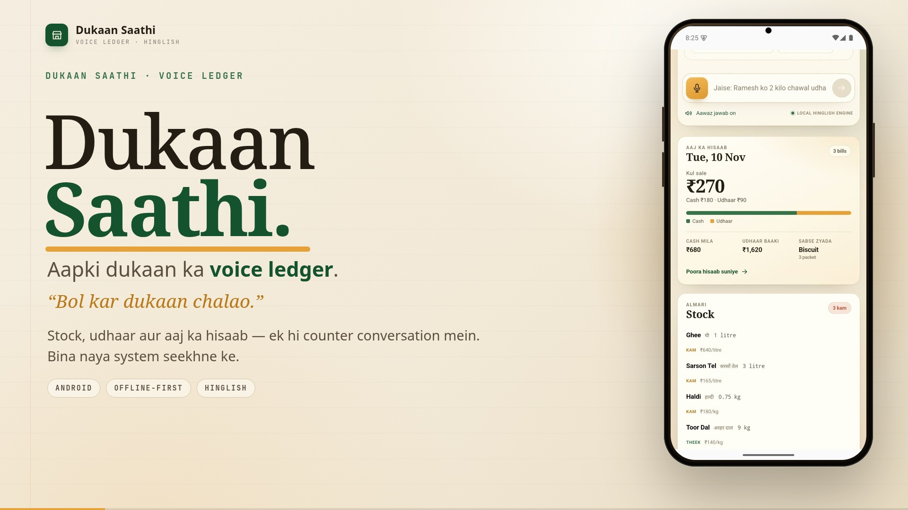
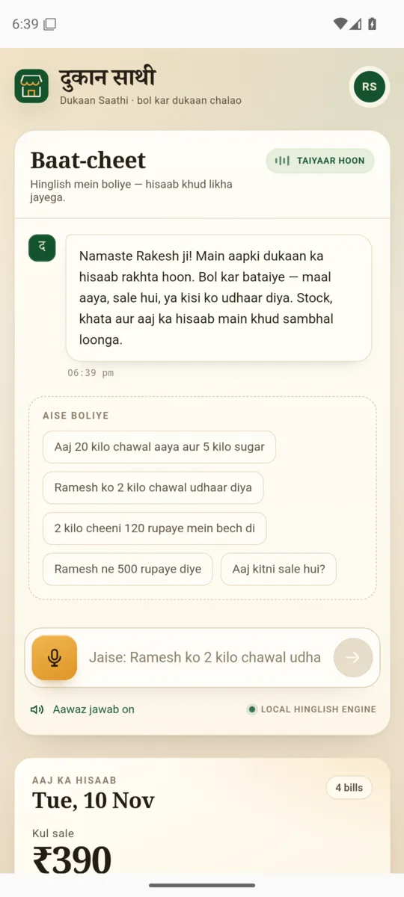
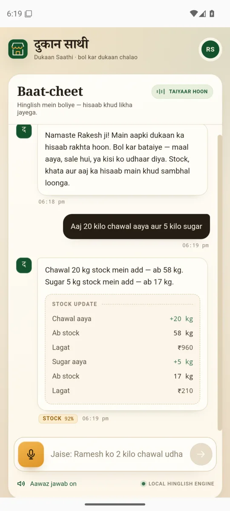
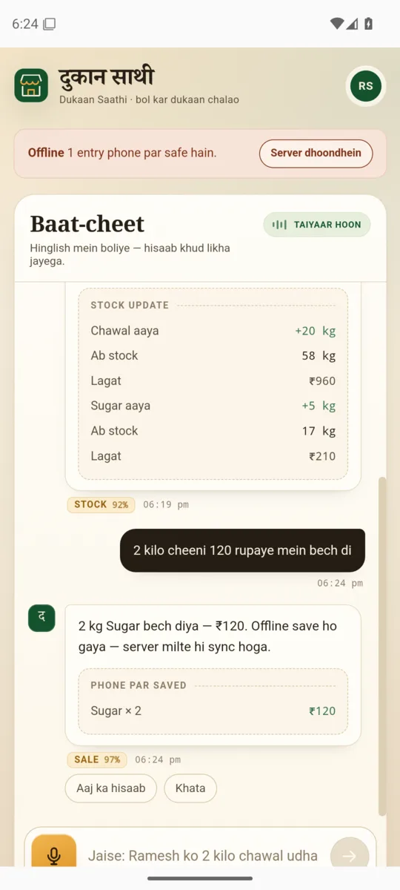
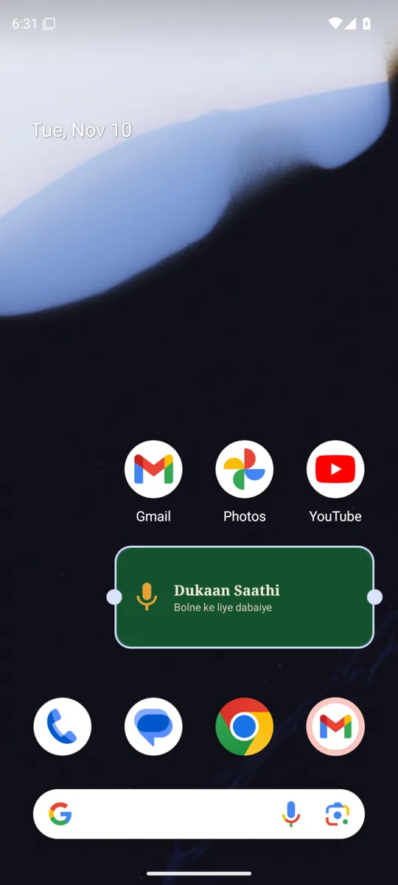

# दुकान साथी · Dukaan Saathi

<a href="docs/demo/dukaan-saathi-demo.mp4">
  
</a>

**▶ [Watch the 82-second demo](docs/demo/dukaan-saathi-demo.mp4)** · 1080p · Hinglish voice-over

**📄 One-page solution pitch:** [PDF](docs/Dukaan-Saathi-Pitch.pdf) · [Markdown](PITCH.md)

**A voice operating system for small shops.** A kirana owner speaks in Hinglish; stock, the
udhaar khata and the day's numbers update themselves.

> “Aaj 20 kilo chawal aaya aur 5 kilo sugar.”
> → two inventory movements, two receipts.
>
> “Ramesh ko 2 kilo chawal udhaar diya.”
> → stock −2 kg, Ramesh's balance +₹120.
>
> “Aaj kitni sale hui?”
> → “Aaj ₹510 ki sale hui — ₹300 cash aur ₹210 udhaar. Cash ₹1,300 mila…”

Built for the [Gnani.ai internship](https://www.gnani.ai/internship) brief and hackathon submission.
Prisma, Evon and Timbre
are integrated at the right seams — with a deterministic Hinglish engine as the always-on fallback,
so the demo works without any API key.

For the one-page solution pitch, the longer submission copy, demo script and field pack, see
[`PITCH.md`](PITCH.md) and [`SUBMISSION.md`](SUBMISSION.md).

## Screenshots

| Dashboard | Voice entry | Offline ledger | Home-screen widget |
| --- | --- | --- | --- |
|  |  |  |  |

---

## Quick start

```bash
npm install
npm run dev          # API on :8787, UI on :5173
```

Open **http://localhost:5173**.

For a production-style run:

```bash
npm run build
npm start            # serves the built UI + API on :8787
```

Also useful:

```bash
npm test             # Hinglish understanding + ledger tests
npm run reset        # restore the demo shop's seed stock, khata and diary
```

Node 20+ (built and tested on Node 26). No database server, no native modules, no build step for
the API.

## Android app

The same interface ships as an installable Android app (`android/`, Capacitor 8). The phone holds
the UI locally and talks to the Node server over the shop's Wi-Fi — the ledger stays authoritative
on the server, so browser and phone see the same shop.

Download the debug APK from the
[v0.1.0 release](https://github.com/palprateek/dukaan-saathi/releases/download/v0.1.0/app-debug.apk)
(5.2 MB). A local build writes the same file to
`android/app/build/outputs/apk/debug/app-debug.apk`.

### Install and connect

```bash
adb install -r app-debug.apk    # the file downloaded from the release
npm run dev        # laptop; note the "Phone / Android app → http://…" line
```

On the laptop, click **Phone jodiye** in the footer and scan the QR with the phone's camera. The QR
is a `dukaansaathi://pair?server=…` link, so the app opens already connected; there is no address
to copy. You can still type the printed LAN address from **Server** in the footer. The address is
remembered. Typed Hinglish always works, and the mic uses the phone's own Hindi recogniser.

### Offline ledger

The phone caches the last shop state and keeps a small outbox in `localStorage` (scoped to the
server address). When the server cannot be reached:

- the dashboard keeps showing the cached shop;
- fully-specified sales, stock-ins, udhaar and vasooli are applied locally and queued with an
  `opId` and the time they happened;
- questions about today's total, stock, low stock and khata are answered from the cache;
- every 15 seconds, on reconnect, and on app foreground the phone probes the server and replays the
  outbox. The server stores applied operation ids in `data/applied-ops.json`, so a retry after a
dropped response cannot double-post a sale. `occurredAt` keeps a sale made yesterday out of today's
total.

Offline mode deliberately refuses underspecified writes (“chawal bech diya”) rather than inventing
a quantity, and undo needs the server.

### Home-screen widget

Long-press the home screen → **Widgets** → **Dukaan Saathi** → drag the mic widget. One tap opens
the app through `dukaansaathi://listen` and starts listening once the shop is ready. The widget is a
native `AppWidgetProvider`; it needs no extra service or background microphone access.

### Rebuild the APK

Requirements: JDK 17–21 and Android SDK 36. Gradle 8.14 does **not** run on JDK 25.

```bash
JAVA_HOME=/path/to/jdk-21 ANDROID_HOME=$HOME/Android/Sdk npm run android:apk
npx cap open android        # optional: open in Android Studio
```

`npm run android:sync` rebuilds the web bundle and copies it into the native project. Launcher icon
and splash are generated from `assets/icon.png` and `assets/splash.png` with `npx capacitor-assets`.

### Native voice

Android WebView implements neither `SpeechRecognition` nor `speechSynthesis`, so the shell uses:

- `@capacitor-community/speech-recognition` — the device recognizer (`hi-IN`, `RECORD_AUDIO`),
  with partial transcripts while the shopkeeper speaks.
- `@capacitor-community/text-to-speech` (`hi-IN`) for replies when Timbre is not configured;
  Timbre audio plays unchanged when it is.

If a phone has no Hindi speech service or the mic permission is denied, the app says so and keeps
the typed path fully functional.

### Connection details

- The API accepts CORS requests and the server binds `0.0.0.0`; the startup log prints the LAN URL.
- Cleartext HTTP is enabled for the LAN demo (`usesCleartextTraffic`).
- The native app stores its server in `localStorage` under `dukaan.apiBase`. Bake a default with
  `VITE_API_BASE=http://192.168.1.5:8787 npm run build` for a fixed shop server.

### Two-minute demo script

Click the suggestion chips or type these in order:

| Say this | What should happen |
| --- | --- |
| `Aaj 20 kilo chawal aaya aur 5 kilo sugar` | Two stock-ins in one breath; both shelves update |
| `Ramesh ko 2 kilo chawal udhaar diya` | Stock −2 kg, Ramesh ₹1,240 → ₹1,360 |
| `2 kilo cheeni 120 rupaye mein bech di` | Sale of ₹120; today's cash sale rises |
| `Ramesh ne 500 rupaye diye` | Vasooli; Ramesh's balance falls to ₹860 |
| `Aaj kitni sale hui?` | Read-out summary + receipt card + spoken reply |
| `Chawal aaya` | Saathi asks “Chawal kitna kilo?” instead of inventing 1 kg |
| `10 kilo` | The pending entry completes |
| `Sunita ko 100 kilo chawal udhaar diya` | Stock is 66 kg; asks before writing a −100 kg entry |
| `10 kilo chawall aaya` | Repairs the ASR spelling to *Chawal*, asks “sahi hai?” |
| `Kya khatam ho raha hai?` | Low-stock list from the actual shelves |
| `Ramesh ka kitna udhaar hai?` | Khata answer with the last entry |
| `Galti ho gayi, undo karo` | Reverses the last entry, restoring stock/balance |

The mic button uses on-device speech recognition (`hi-IN`) — the Web Speech API in Chrome/Edge,
and the Android recogniser in the app. Typing Hinglish always works and produces the same state
changes — useful in a noisy room or an unsupported browser.

---

## Why this is not a chatbot

The unit of work is a **ledger movement**, not a message.

- **Writes are real and reversible.** Every stock, sale, udhaar and vasooli is a transaction with
  an ID; undo reverses its effect on stock and balances.
- **Ambiguity is resolved before writing.** Missing item, quantity, customer or amount becomes a
  question with chips. A repaired ASR spelling and a stock-shortfall sale both need a “haan”.
- **The assistant never invents numbers.** Summaries, stock answers and khata answers are computed
  from state. Prices used for credit come from the item's rate card.
- **One turn can contain several clauses.** “20 kilo chawal aaya aur 5 kilo sugar” updates two
  items; the reply is one receipt with both lines.
- **Speech is only the input.** The same command path serves typed Hinglish, Prisma transcripts and
  browser recognition, so the demo is testable and reproducible.

---

## Architecture

```
                  ┌──────────────────────── browser ────────────────────────┐
                  │  push-to-talk  ·  typed Hinglish  ·  receipt cards      │
                  │  SpeechRecognition (hi-IN)  ·  SpeechSynthesis / Timbre │
                  └───────────────┬─────────────────────────────▲──────────┘
                        POST /api/turn · audio                │ reply + receipt
                                  │                          │ + choices + state
┌─────────────────────────────────▼──────────────────────────┴──────────────┐
│ Express API (server/index.ts)                                             │
│                                                                           │
│  dialogue engine (server/engine.ts)                                       │
│   ├─ session pending slot / confirmation (5 min TTL)                      │
│   ├─ Evon adapter (optional) ──► transaction JSON                         │
│   ├─ local Hinglish engine (always)                                       │
│   │    normalise → intent scoring → entity extraction → slot planner      │
│   ├─ ledger: stock × qty · khata balance · daily summary · undo           │
│   └─ atomic JSON store (data/shop.json)                                   │
│                                                                           │
│  Prisma adapter (optional): multipart /stt/v3, shop keyterms              │
│  Timbre adapter (optional): /tts/inference → WAV → base64                 │
└───────────────────────────────────────────────────────────────────────────┘
```

### The understanding pipeline

`server/nlu/`

1. **Normalise** — lowercase, Devanagari digits → ASCII, unify ₹/rupees, split glued units
   (`2kg` → `2 kg`), keep decimals.
2. **Match shop vocabulary** — every item has Latin, Devanagari and loanword aliases
   (`chawal`, `चावल`, `rice`). Exact aliases win; otherwise a phonetic key plus edit distance
   repairs ASR slips (`chawall` → `chawal`, `chini` → `cheeni`). Repairs are marked *fuzzy* and
   confirmed once.
3. **Score intents** — weighted keyword evidence, with a question bias so
   “aaj kitni **sale** hui” is a summary, not a sale. Query intents outrank transactional ones.
4. **Extract entities**
   - quantities: digits, Hindi words (`bees`, `पांच`), phrases (`do sau pachas` = 250),
     fractions (`dedh` = 1.5), unit conversion (500 g → 0.5 kg)
   - money: `₹`, `rupaye`, `<n> ka`, bare numbers in payment/credit/rate contexts
   - people: token before `ko` / `ne` / `ka`, filtered against item aliases and stopwords, then
     matched to the khata phonetically
5. **Plan missing slots** — the engine asks only for what is absent, and merges the answer into
   the same pending command.
6. **Guard writes** — stock shortfall and fuzzy item get a confirmation. Only then does the
   ledger mutate, in one atomic store write.

`server/nlu/parser.test.ts` covers the parser in isolation; `server/engine/engine.test.ts` drives
the full dialogue and asserts on persisted shop state.

---

## Gnani integration

The product mapping is deliberate:

| Gnani | Role here | Code | Status |
| --- | --- | --- | --- |
| **Prisma** | Hinglish speech → text | `transcribeWithPrisma` in `server/gnani.ts`, `POST /api/voice/transcribe` | Live-tested with a real key: Hinglish WAV → Devanagari transcript |
| **Evon** | Intent + transaction extraction, ambiguity reasoning | `understandWithEvon` in `server/gnani.ts` | Endpoint-driven seam; needs a deployment URL, local engine is the reference |
| **Timbre** | Spoken confirmations and summaries | `speakWithTimbre` in `server/gnani.ts`, `POST /api/tts` | Live-tested with a real key: playable 24 kHz WAV |

### Prisma (STT)

Real contract, as documented at `docs.gnani.ai` (verified November 2026):

- `POST https://api.vachana.ai/stt/v3`, `multipart/form-data`, header `X-API-Key-ID`.
- Fields: `audio_file`, `language_code`, `model`, `format=transcribe` (ITN turns spoken numbers
  into digits), plus `keyterms` + `topic` on Prisma v3.0.
- Defaults here: `model=prisma-v3.0`, `language_code=hi-IN,en-IN`, so mixed Hinglish is expected
  rather than treated as a mistake.

The adapter injects the shop's own vocabulary as keyterms — item names, aliases and customer names
— which is the difference between a generic transcript and one that hears *chawal*, *cheeni* and
*Ramesh* correctly.

Live check: Timbre synthesised “Ramesh ko do kilo chawal udhaar diya”, Prisma returned
`रमेश को 2 किलो चावल उधार दिया।`, and the ledger recorded ₹120 against Ramesh. Because Prisma
returns native script, customers now carry an optional `nameHi` and the parser matches Devanagari
names (and Devanagari case markers such as `को`) to the existing khata.

### Evon (understanding)

Evon is Gnani's language model, not a public “extract my transactions” REST endpoint. Dukaan Saathi
therefore defines a narrow, inspectable contract at `GNANI_EVON_URL`:

```jsonc
// request
{
  "transcript": "Ramesh ko 2 kilo chawal udhaar diya",
  "language": "hi-IN",
  "domain": "kirana_shop",
  "context": { "items": [{ "name": "Chawal", "unit": "kg", "price": 60, "stock": 38 }],
                "customers": [{ "name": "Ramesh", "balance": 1240 }] },
  "schema": "intent, item, quantity, unit, amount, customer, confidence"
}

// response
{ "transactions": [{ "intent": "credit", "item": "Chawal",
                     "quantity": 2, "unit": "kg", "customer": "Ramesh",
                     "confidence": 0.93 }] }
```

Point `GNANI_EVON_URL` at the Evon deployment (or a thin proxy around it). Evon's answer is mapped
into the same `ParsedCommand` the local engine produces, so ledger execution, guard rails and the
UI are identical. If the call fails or returns nothing, the local engine handles the turn — a voice
integration must never stop a shopkeeper from recording a sale.

### Timbre (TTS)

- `POST https://api.vachana.ai/api/v1/tts/inference`, `X-API-Key-ID`, JSON body
  `{ text, voice, model, language, speed, audio_config }`; the response is the complete audio as
  binary.
- Defaults: `timbre-v2.5`, voice **Poorvi** (Gnani's Hinglish voice), `language=hi-IN`.
- `audio_config` explicitly requests `container=wav`, 24 kHz, mono, 16-bit. Without it this key
  returned headerless PCM with `application/octet-stream`, which browsers cannot play.
- The server base64-encodes the WAV; the browser plays it after a reply. Without Timbre, the same
  reply is spoken through `SpeechSynthesis` with a Hindi voice.

**Live status:** Prisma and Timbre were exercised with a real key. Timbre returned a valid RIFF/WAV
(24 kHz, mono, `pcm_s16le`), Prisma transcribed it, and the transcript moved the khata. Evon remains
endpoint-driven: Gnani publishes Evon as an open-weights model rather than a hosted transactional
REST API, so `GNANI_EVON_URL` must point at a deployment or proxy. All failure paths still fall back
to the local engine. The demo UI uses on-device recognition; the Prisma endpoint is ready for a
recorded clip (WAV/MP3/OGG/FLAC/M4A). Recording a clip in-browser and uploading it is the next
wiring step for a fully Prisma-driven voice path.

### Configuration

Copy `.env.example` → `.env`:

```bash
GNANI_API_KEY=...
# optional overrides
GNANI_PRISMA_MODEL=prisma-v3.0
GNANI_TIMBRE_VOICE=Poorvi
GNANI_EVON_URL=https://your-evon-deployment/understand
```

The server reads `.env` at startup (real environment variables take precedence). Nothing else
changes: no key → fully local; key → Prisma/Timbre are used, with local fallback.

---

## Ledger and data model

`shared/types.ts` — shared by server and browser.

| Concept | Rule |
| --- | --- |
| `Item.stock` | In the item's own unit; gram/ml inputs are converted into kg/litre |
| `Customer.balance` | Positive = customer owes the shop; negative = advance paid |
| `Txn` | Immutable movement: `stock_in`, `sale`, `credit`, `payment`, `price`, `adjust` |
| `sale` | Stock −qty, cash sale +amount, counts as a bill |
| `credit` | Stock −qty, khata +amount, counted in the day's sale value |
| `payment` | Khata −amount, cash received +amount |
| `stock_in` | Stock +qty, purchase value at cost price |
| `DaySummary` | Goods sold (cash + udhaar), cash sale, cash received, udhaar given, purchases, top item, low stock, outstanding khata |
| `undo` | Reverses the last non-seed movement's stock and balance effect, then removes it |

The store is a single JSON file (`data/shop.json`) written atomically via temp file + rename.
Seed data creates Sharma Kirana Store with 14 items, 4 khata entries and five of today's movements,
so the dashboard tells a story on first load.

---

## Project layout

```
shared/types.ts               API contract shared by client and server
server/
  index.ts                    Express routes, CORS, static hosting, LAN hint, pairing, replay
  engine.ts                   dialogue state, writes, queries, undo, receipts
  ops.ts                      durable op-id set so offline replays are idempotent
  store.ts                    seed, atomic JSON persistence, daily summary
  gnani.ts                    Prisma / Evon / Timbre adapters
  reset.ts                    demo reset CLI
  nlu/
    lexicon.ts                item aliases, units, Hindi number words, intent keywords
    normalize.ts              normalisation, phonetic key, edit distance, ₹ formatting
    parser.ts                 intent scoring, entity extraction, slot planning
    parser.test.ts
  engine/engine.test.ts
src/
  App.tsx                     app state, bootstrap, turn loop, reset, native server gate
  components/Conversation.tsx composer, mic, messages, receipts, choices
  components/Dashboard.tsx    today, stock, khata, diary cards
  components/ServerSetup.tsx  native first-run / server switch screen
  components/PhonePairing.tsx QR pairing modal on the laptop
  components/Icons.tsx
  lib/api.ts                  API base, native probes, all HTTP calls, pairing
  lib/offline.ts              cached shop, local queries, optimistic writes, outbox
  lib/pairing.ts              `dukaansaathi://pair` and `://listen` link parsing
  lib/useVoice.ts             browser + native STT/TTS, Timbre playback
  lib/format.ts
  styles.css                  warm paper / deep green / marigold design system
android/                      Capacitor 8 Android shell (generated, branded)
assets/                       icon/splash sources for the launcher
capacitor.config.ts           app id, webDir, cleartext LAN config
```

### API

| Method | Path | Purpose |
| --- | --- | --- |
| `GET` | `/api/bootstrap` | Shop state, summary, examples, integration flags, session id |
| `POST` | `/api/turn` | `{ text, sessionId, source, opId?, occurredAt? }` → reply, receipt, choices, state, summary; repeated `opId` is acknowledged without writing twice |
| `GET` | `/api/state` | Current state + summary |
| `GET` | `/api/pair` | LAN server URL, `dukaansaathi://pair` deep link and QR SVG |
| `POST` | `/api/voice/transcribe` | Raw audio → Prisma transcript (501 without a key) |
| `POST` | `/api/tts` | `{ text }` → Timbre audio (501 without a key) |
| `POST` | `/api/reset` | Restore demo seed |

---

## What is deliberately left out

- One shop, one device, no accounts. Data is a local JSON file; Postgres + auth is the obvious
  multi-shop step.
- No GST invoices, returns/exchanges, supplier purchase orders or barcode scanning.
- No streaming ASR yet. Prisma's WebSocket endpoint (`/stt/v3/stream`) is the right upgrade for
  sub-second push-to-talk in a noisy shop; the REST adapter is the 30-second-clip version.
- Browser speech recognition is Chrome/Edge-only. The typed path is always available.
- Evon's production contract needs to be confirmed with Gnani: tool/JSON schema, language hints and
  confidence calibration. The seam and fallback are ready for it.
- Voice biometrics (another Gnani capability) would be a strong next layer: only the enrolled
  shopkeeper or family member should be able to write to the khata by voice.
- Offline support is a cached JSON snapshot plus a single device's `localStorage` outbox, not a
  full on-device database. Two phones editing the same shop offline would need per-field conflict
  resolution; SQLite/CRDT sync is the next step.
- The home-screen widget opens the app and starts the mic; it does not record in the background or
  show a transcript on the widget itself.

## Verification

- `npm test` — 24 passing tests across parser and full dialogue/ledger (multi-item stock-in,
  credit, sale, vasooli, summary, slot filling, stock guard, ASR repair, Devanagari, rate change,
  undo).
- `npm run build` — TypeScript check + production Vite build.
- API smoke-tested end to end against the production server: bootstrap, eleven consecutive turns,
  clarification, confirmation cancellation, reset.
- Android debug APK: assembled with Gradle 8.14.3, JDK 21 and compileSdk 36; inspected with
  `aapt2` — package `ai.gnani.dukaansaathi`, `INTERNET` + `RECORD_AUDIO`, cleartext LAN enabled,
  speech-recognition `<queries>`, `dukaansaathi://pair` + `://listen` intent filters,
  `VoiceWidgetProvider` receiver and widget resources, bundled UI, launcher icons and splash.
- Pairing endpoint returns the LAN URL and a valid SVG QR; the deep-link parser was exercised for
  both hosts and rejects unrelated URLs.
- Offline harness against the seed shop: udhaar updated the khata and stock, local summary and
  low-stock queries answered, underspecified sales refused, stock-in applied; replaying the same
  `opId` against the server left the transaction count unchanged, and `occurredAt` preserved a
  yesterday timestamp.
- CORS preflight and a cross-origin `/api/turn` were exercised against the production server.
- Android runtime test on an Android 15 (API 35) x86_64 emulator with the debug APK: first-run
  connect screen, cold-start `dukaansaathi://pair` deep link (lands on the live dashboard), typed
  stock-in updating stock/summary, offline sale with banner + local receipt, automatic replay after
  restart (server total ₹270 → ₹390, queue cleared), microphone permission dialog, native Google
  TTS synthesis in `hi-IN`, widget placement on the home screen, and tapping the widget to open the
  app and start listening.
- Live Gnani test with a real key: Timbre returned a playable 24 kHz WAV; Prisma transcribed the
  Hinglish clip as `रमेश को 2 किलो चावल उधार दिया।`; the turn engine recorded ₹120 against Ramesh
  (₹1,240 → ₹1,360) and reduced Chawal 38 → 36 kg. Evon was not live-tested because no deployment
  URL is configured.
- Not verified: human microphone capture on physical hardware (the headless emulator has no
  microphone input, so the recogniser starts but returns “No match”); QR camera handoff on physical
  hardware. The deep-link and intent-filter paths the QR uses were exercised directly.
