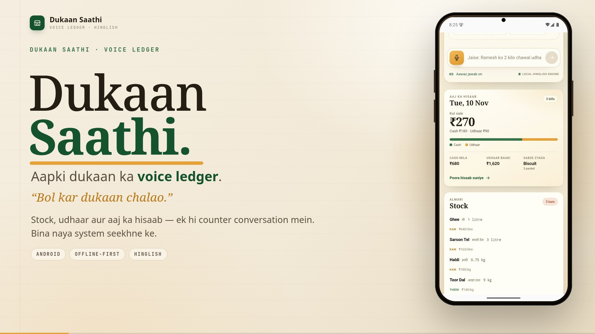

# Dukaan Saathi — submission copy

**One-page pitch:** [`docs/Dukaan-Saathi-Pitch.pdf`](docs/Dukaan-Saathi-Pitch.pdf) (PDF, 1 page) ·
[`PITCH.md`](PITCH.md) (Markdown)

**One line:** A Hinglish voice operating system for kirana shops: speak once, and stock, udhaar
khata and the day's numbers update themselves.

## The problem

A kirana owner already knows the entry they want to make. The friction is the notebook, the app
form, and the ten taps between remembering and recording. Existing voice assistants answer
questions; they do not safely mutate a shop ledger.

## The solution

Dukaan Saathi treats a spoken sentence as a **ledger movement**, not a chat message.

- “Ramesh ko 2 kilo chawal udhaar diya” → stock −2 kg, Ramesh +₹120.
- “Aaj 20 kilo chawal aaya aur 5 kilo sugar” → two stock-ins from one breath.
- “Aaj kitni sale hui?” → a computed answer, never an invented number.
- Ambiguous writes ask one precise question; stock shortfalls and fuzzy ASR repairs need a “haan”.
- Every write is reversible with “undo karo”.

The same command path serves typed Hinglish, Prisma transcripts and device speech recognition. The
local deterministic engine is both the reference implementation and the always-on fallback.

## Why it fits Gnani

| Gnani | Use in Dukaan Saathi | Status |
| --- | --- | --- |
| **Prisma** | Hinglish speech → text, with the shop's item and customer names as keyterms | **Live-tested** |
| **Timbre** | Spoken confirmations and summaries through the Poorvi Hinglish voice | **Live-tested** |
| **Evon** | Intent and transaction extraction seam, behind `GNANI_EVON_URL` | Endpoint-driven; local engine is the fallback |

Live proof from testing: Timbre synthesised “Ramesh ko do kilo chawal udhaar diya”, Prisma returned
`रमेश को 2 किलो चावल उधार दिया।`, and the ledger recorded ₹120 against Ramesh (₹1,240 → ₹1,360,
Chawal 38 → 36 kg).

## What is different

- **State, not answers.** Every turn is validated against stock, prices and khata before one atomic
  write. The assistant never invents a quantity, price or balance.
- **Works when the network does not.** The Android app caches the shop and queues fully-specified
  writes with an `opId` and `occurredAt`; the server replays them idempotently when it returns.
- **A real Android shell.** Native Hindi speech recognition, TTS, QR pairing and a home-screen mic
  widget, not a browser shortcut.
- **The fallback is a product feature.** With no API key the demo is fully usable; with a key,
  Prisma and Timbre light up without changing the UI or the ledger rules.

## Demo

[](docs/demo/dukaan-saathi-demo.mp4)

**▶ [Watch the 82-second demo](docs/demo/dukaan-saathi-demo.mp4)** — 1080p, Hinglish voice-over.
The beats below are what the film shows, in order.

## 60–90 second demo script

1. Open the dashboard. Say or tap: **“Aaj 20 kilo chawal aaya aur 5 kilo sugar.”**
   Show two stock movements in one receipt.
2. Say: **“Ramesh ko 2 kilo chawal udhaar diya.”**
   Show Ramesh's khata rise and Chawal fall.
3. Ask: **“Aaj kitni sale hui?”** Show the computed summary and hear the reply.
4. Turn off Wi-Fi / stop the server. Say: **“2 kilo cheeni 120 rupaye mein bech di.”**
   Show the offline banner and “phone par saved” receipt.
5. Restart the server. Show the queue sync automatically and the server total update.
6. Go home and tap the **Dukaan Saathi** widget. Show it opening straight into listening.

## Run it

```bash
npm install
npm run dev          # http://localhost:5173
npm test
npm run build && npm start
```

Android debug APK: [download v0.1.0](https://github.com/palprateek/dukaan-saathi/releases/download/v0.1.0/app-debug.apk)
(5.2 MB). Setup, QR pairing, offline limitations and the full API contract are in
[`README.md`](README.md).

## Tech stack

React 19, TypeScript, Vite, Express 5, atomic JSON store, Capacitor 8, native Android
(SpeechRecognizer, TextToSpeech, AppWidgetProvider), Gnani Prisma / Timbre / Evon seam.

## Honest limitations

- One shop, one device, no accounts or multi-device conflict resolution.
- Evon needs a deployment URL; it is not a hosted transactional endpoint.
- The Prisma endpoint accepts recorded clips, but the mobile mic still uses the device recogniser.
- Live human microphone input and QR camera handoff were not testable on the headless emulator.
- The demo video feeds the emulator a simulated microphone transcript; everything after recognition —
  Hinglish parsing, stock and khata writes, the offline queue, sync and the widget launch — runs for real.

## Team

Built by **Prateek Pal** — [github.com/palprateek](https://github.com/palprateek).
