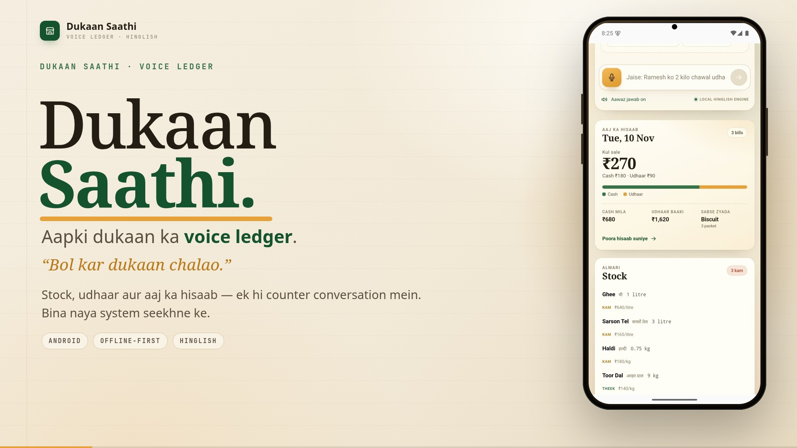

# Dukaan Saathi — 82-second demo

**▶ [Watch the demo](dukaan-saathi-demo.mp4)**

One kirana counter, six real beats:

1. **Stock in** — “Aaj 20 kilo chawal aaya aur 5 kilo sugar.” Two movements, one receipt.
2. **Udhaar** — “Ramesh ko 2 kilo chawal udhaar diya.” Stock falls, the khata rises.
3. **Sawaal** — “Aaj kitni sale hui?” A computed answer, not a guess.
4. **Offline** — the server stops; the sale is saved on the phone with the offline banner.
5. **Sync** — the server returns; the queue drains and the total updates itself.
6. **Widget** — one tap on the home-screen mic opens straight into listening.

1080p, 30fps, Hinglish voice-over. The emulator's microphone transcript is simulated; the Hinglish
parsing, ledger writes, offline queue, sync and widget launch are real. The APK is on the
[v0.1.0 release](https://github.com/palprateek/dukaan-saathi/releases/tag/v0.1.0).
